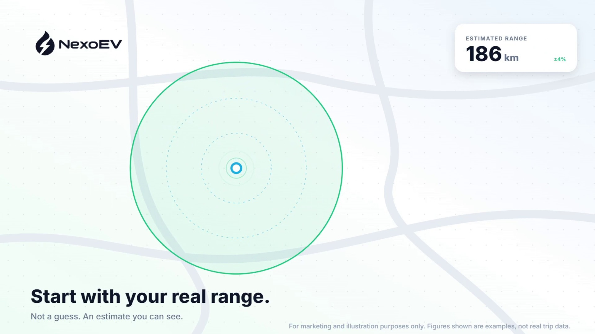
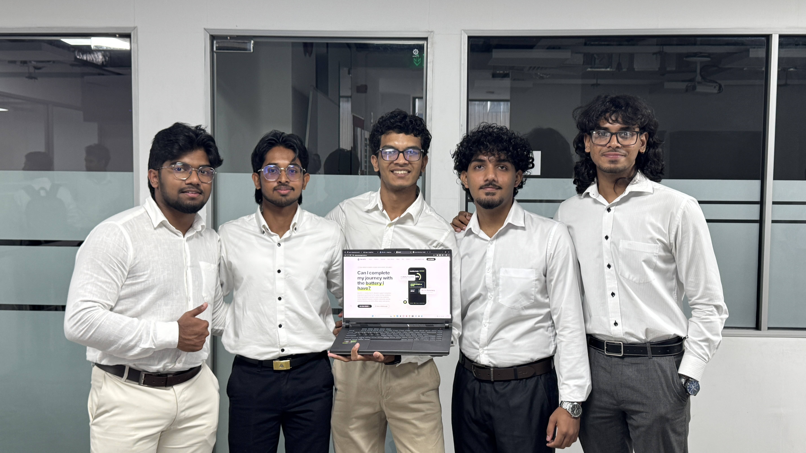

<div align="center">


<h3>Intelligent EV Range & Journey Support Platform for Sri Lanka</h3>

<p>
  <strong>"Can I complete my journey with the battery I have?"</strong><br />
  Official product showcase and interactive web experience for <strong>NexoEV</strong> — an elevation-aware, offline-ready EV companion built for Sri Lankan driving conditions.
</p>

<p>
  
  
  
  
  
</p>

<p>
  <a href="#overview">Overview</a> •
  <a href="#visual-preview">Visual Preview</a> •
  <a href="#core-capabilities">Capabilities</a> •
  <a href="#tech-stack--structure">Tech Stack</a> •
  <a href="#getting-started">Getting Started</a> •
  <a href="#team">Team</a>
</p>

</div>

---

## Visual Preview

<div align="center">
  
  <br />
  <sub><em>NexoEV Range Preview — Visualized arrival battery &amp; live estimated range</em></sub>
</div>

<br />

<div align="center">
  
  <br />
  <sub><em>Animated journey flow illustrating dynamic battery-on-arrival estimates and community-trusted charging stops</em></sub>
</div>

---

## Overview

Generic global EV navigation apps assume flat terrain and steady climates, while local directories often show only static charger pins without journey feasibility or station reliability.

**NexoEV** is a mobile-first EV decision-support platform designed specifically for **Sri Lankan road realities** — combining dynamic mountain elevation modeling, official highland hazard awareness, charging expense tracking in LKR, and zero-hardware offline route packs.

This repository hosts the **NexoEV web showcase** built with **React 18** and **Vite**, featuring:
- Interactive 8-module platform explorer (`Platform`) paired with live phone UI mockups (`PhoneMockup` & `AppScreens`)
- 18-second product walkthrough video player (`VideoShowcase`) and interactive 1-on-1 walkthrough booking modal (`WalkthroughModal`)
- Beta waitlist signup (`WaitlistCTA`) and contact form (`Contact`) powered by Formspree
- Dedicated `/about` route (`AboutPage`) highlighting project mission, technical highlights, and the engineering team

---

## Core Capabilities

| # | Module | Highlights |
| :-: | :--- | :--- |
| **01** | **Adaptive Range Engine** | Factors personal driving behavior, steep hill-country climbs, downhill regenerative braking, payload, and cabin AC draw. Evaluates routes into 3 feasibility tiers (**Likely Feasible**, **Caution**, **Stop Required**) with a **97.7%** tested arrival accuracy. |
| **02** | **Highland Corridor Safety** | Protects routes across Kadugannawa, Ramboda Pass, Nuwara Eliya, and Ella by correlating road segments with **NBRO** landslide advisories and Dept. of Meteorology weather notices. |
| **03** | **EV Journey Expense Tracker** | Logs charging sessions, kWh added, and monthly operating expenses in **Sri Lankan Rupees (LKR)** with cost-per-km comparisons against petrol vehicles. |
| **04** | **Smart Charger Finder** | Ranks nearby stations across **CEB**, **chargeNET**, **Greeneme**, and independent hubs by reachability, connector compatibility (**CCS2**, **Type 2**, **CHAdeMO**), charging speed, and driver-verified uptime check-ins. |
| **05** | **Shareable Briefs & Templates** | Generates shareable web links for live ETA and arrival battery status, plus 1-tap saved corridor templates (e.g. *Colombo ⇄ Kandy*). |
| **06** | **Trilingual Assistance Centre** | Full support in **English**, **Sinhala (සිංහල)**, and **Tamil (தமிழ்)** with EV flatbed-only towing rules and a plain-language dashboard warning glossary. |
| **07** | **Zero-Hardware & Offline Ready** | Runs directly on smartphones without OBD-II dongles; caches **Offline Journey Packs** and map tiles for zero-signal mountain passes. |
| **08** | **Verified Reliability** | Backed by 18 automated test suites and empirical testing across diverse coastal, urban, and highland Sri Lankan routes. |

---

## Tech Stack & Structure

- **Frontend:** [React 18](https://react.dev/) (`react`, `react-dom`)
- **Bundler:** [Vite 8](https://vite.dev/) (`vite`, `@vitejs/plugin-react`)
- **Icons:** [Lucide React](https://lucide.dev/) (`lucide-react`)
- **Forms & Waitlist:** [Formspree](https://formspree.io/) (`VITE_FORMSPREE_FORM_ID`)
- **Hosting / Routing:** [Vercel](https://vercel.com/) SPA rewrites configured in `vercel.json`

```text
WEBSITE/
├── public/
│   ├── partners/              # University & module logos (IIT, Westminster, ATP)
│   ├── team/                  # Team member portraits (member-1.jpg .. member-5.jpg)
│   ├── favicon.ico            # Site icon
│   ├── logo.png               # Full NexoEV brand logo
│   ├── logo-mark.png          # Compact NexoEV icon mark
│   ├── Main_Edit_with_audio.mp4  # 18-second product walkthrough video
│   ├── nexoev-journey.svg     # Animated EV journey diagram
│   ├── team-photo.jpg         # Group photo of the NexoEV team
│   └── video-poster.jpg       # Video showcase poster & hero visual
├── src/
│   ├── components/            # Reusable UI (Navbar, Footer, PhoneMockup, AppScreens, Preloader, WalkthroughModal, ...)
│   ├── data/
│   │   └── team.js            # Team member profiles, roles, and links
│   ├── hooks/
│   │   └── useReveal.js       # IntersectionObserver scroll-reveal hook
│   ├── pages/
│   │   └── AboutPage.jsx      # /about page with mission, values, and team cards
│   ├── sections/              # Landing sections (Hero, Platform, Benefits, Features, HowItWorks, VideoShowcase, About, FAQ, Contact, WaitlistCTA)
│   ├── styles/                # Component & section CSS modules
│   ├── App.jsx                # Root router (/ and /about) & layout
│   ├── config.js              # Store URLs, social handles, contact email & Formspree endpoint
│   └── main.jsx               # React entry point
├── .env.example               # Sample Formspree environment variable
├── index.html                 # Document shell & Inter font import
├── package.json               # Scripts & dependencies
├── vercel.json                # Vercel SPA rewrite configuration
└── vite.config.js             # Vite configuration
```

---

## Getting Started

### Prerequisites

- **Node.js** `18+` (or `20+` / `24+`) and **npm**

### Local Setup

```bash
# 1. Clone the repository
git clone https://github.com/vihasgamage2007-spec/nexoev-website.git
cd nexoev-website

# 2. Install dependencies
npm install

# 3. Start the development server (http://localhost:5173)
npm run dev
```

### Build & Preview

```bash
# Build production bundle into dist/
npm run build

# Preview the production build locally
npm run preview
```

### Configuration

1. **Formspree (Contact, Walkthrough & Waitlist forms):**
   Copy `.env.example` to `.env` and set your Formspree form ID (or configure it directly in `src/config.js`):
   ```env
   VITE_FORMSPREE_FORM_ID=your_formspree_id
   ```
2. **Store Links, Email & Social Handles:**
   Update `STORE_URLS`, `CONTACT_EMAIL`, and `SOCIAL_LINKS` in [`src/config.js`](src/config.js).
3. **Team Profiles:**
   Update member names, roles, portraits, and links in [`src/data/team.js`](src/data/team.js).

### Deploying to Vercel

`vercel.json` already configures client-side SPA routing (`/(.*) -> /index.html`), so `/about` and deep links work out of the box on Vercel:

- **Framework Preset:** `Vite`
- **Build Command:** `npm run build`
- **Output Directory:** `dist`

---

## Team

<div align="center">
  
  <br />
  <sub><em>NexoEV Core Team — Designing the next generation of electric mobility</em></sub>
</div>

<br />

<table>
  <tr>
    <td align="center" width="20%">
      <br />
      <strong>Yehen Silva</strong><br />
      <sub>Project Manager &amp; Developer</sub><br />
      <a href="https://github.com/YehenSilva">@YehenSilva</a>
    </td>
    <td align="center" width="20%">
      <br />
      <strong>Sansitha Mayadunna</strong><br />
      <sub>Research &amp; Developer</sub><br />
      <a href="https://github.com/V-San07">@V-San07</a>
    </td>
    <td align="center" width="20%">
      <br />
      <strong>Vihas Sethika</strong><br />
      <sub>Frontend Developer</sub><br />
      <a href="https://github.com/vihasgamage2007-spec">@vihasgamage2007-spec</a>
    </td>
    <td align="center" width="20%">
      <br />
      <strong>Udew Bimsara</strong><br />
      <sub>Backend Developer</sub><br />
      <a href="https://github.com/udewbimsara">@udewbimsara</a>
    </td>
    <td align="center" width="20%">
      <br />
      <strong>Ganith Gunasekara</strong><br />
      <sub>QA &amp; Testing</sub><br />
      <a href="https://github.com/ganithgunasekara">@ganithgunasekara</a>
    </td>
  </tr>
</table>

---

## Academic Project Context

Developed as a student group project for the **5COSC021C — Agile Team Project** module at the **Informatics Institute of Technology (IIT Sri Lanka)** in collaboration with the **University of Westminster**.

<div align="center">
  
  &nbsp;&nbsp;&nbsp;&nbsp;
  
  &nbsp;&nbsp;&nbsp;&nbsp;
  
</div>

---

## Connect

- **Email:** [nexoev12@gmail.com](mailto:nexoev12@gmail.com)
- **Instagram:** [@nexo.ev](https://www.instagram.com/nexo.ev/)
- **TikTok:** [@nexo.ev](https://www.tiktok.com/@nexo.ev)
- **Facebook:** [NexoEV](https://www.facebook.com/profile.php?id=61596396120439)
